# DESPLIEGUE EN RENDER USANDO DOCKER

🔗 [Repositorio GitHub](https://github.com/josemi1189/mod8-render-docker)

🔗 [Despliegue en Render con Docker](https://mod8-render-docker.onrender.com)

1. Debemos generar los archivos de configuración para generar la imagen en **Docker Hub**. Se debe optimizar la imagen de forma que contenga solo los archivos necesarios.

   `Dockerfile`:

   ```docker
   # Crea fase base, genera carpeta contenedora e indica directorio de trabajo
   FROM node:24-alpine AS base
   RUN mkdir -p /usr/app
   WORKDIR /usr/app

   # Copia ficheros dentro del directorio de trabajo establecido, instala dependencias y genera build
   FROM base  AS front-build
   COPY ./ ./
   RUN npm install
   RUN npm run build

   # Copia los archivos necesarios para despliegue
   FROM base AS release
   COPY --from=front-build /usr/app/dist ./public
   COPY ./server/package.json ./
   COPY ./server/package-lock.json ./
   COPY ./server/index.js ./

   # Instala dependencias omitiendo las de desarrollo
   RUN npm ci --omit=dev

   CMD ["node", "index.js"]
   ```

   `.dockerignore`: Debe incluir todo lo que no sea necesario subir a Docker. Si utilizamos .env.production no deberá incluirse para permitir su subida.

   ```
   node_modules
   dist
   .github
   .gitignore
   .env.development
   ```

2. Generar imagen del repositorio con la versión que corresponda:

   `docker build -t <nombre-app>:<número de versión> .`

   ```
   docker build -t render-docker:1 .
   ```

   **NOTA:** El comando incluye un punto . al final necesario que indica la ruta o directorio donde se encuentra el archivo Dockerfile y permite indicar directorio al que le queremos dar acceso.

3. Una vez ejecutado el comando, podemos comprobar si la imagen se ha compilado correctamente con el comando `docker images`:

   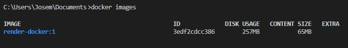

4. Crear contenedor Docker y confirmar que la aplicación carga correctamente.

   `docker run --name <nombre-contenedor> -p <puerto local:puerto del proceso del contenedor> - e PORT=<puerto> <nombre-imagen>:<versión>`

   ```
   docker run --name render-docker-container -p 8083:8083 render-docker:1
   ```

   🔗 [http://localhost:8083](http://localhost:8083)

   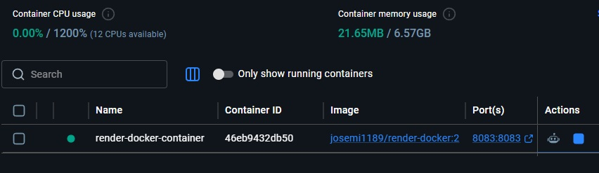

   > Permite generar tantos contenedores como sean necesarios utilizando distinto nombre de contenedor y distinto puerto.

   ```
   docker run --name render-docker-container2 -p 8083:8083 render-docker:1
   ```

5. Publicar imagen en Dockerhub.
   1. Es necesario estar logueado en docker para tener acceso mediante línea de comandos. Podemos loguearnos o confirmar que lo estamos ejecutando:

      ```
      docker login
      ```

   2. Para subir la imagen a DockerHub, el nombre debe incluir nuestro nombre de usuario. Si en local hemos creado la imagen sin utilizar formato `usuario-docker/nombre-imagen`, es posible asignarle un alias para que nos permita publicarla.

      `docker tag \<imagen-local:versión> \<usuario>/\<nombre-imagen:version>`

      ```
      docker tag render-docker:1 josemi1189/render-docker:1
      ```

   3. Subir imagen a Docker Hub:

      `docker push \<alias-imagen-creada>`

      ```
      docker push josemi1189/render-docker:1
      ```

      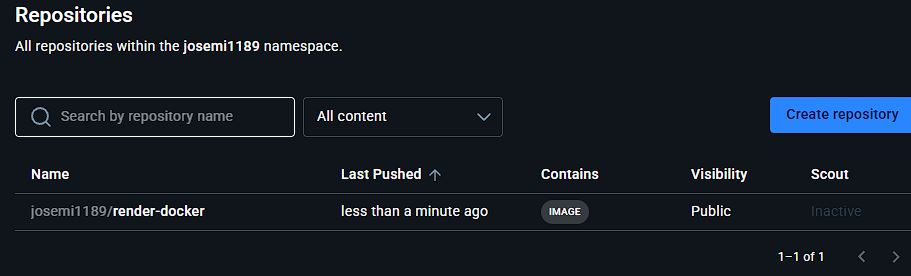

   4. De esta forma se compila con la arquitectura del sistema de nuestro equipo. Para compilar con distintas arquitecturas podemos ejecutar el comando:

      `docker buildx build --platform linux/amd64,linux/arm64 -t <nombre_repositorio_dockerHub:versión> <--push (opcional)> .`

      > --push: Publica la imagen multi-arquitectura en Docker Hub.

      ```
      docker buildx build --platform linux/amd64,linux/arm64 -t josemi1189/render-docker:2 --push .
      ```

      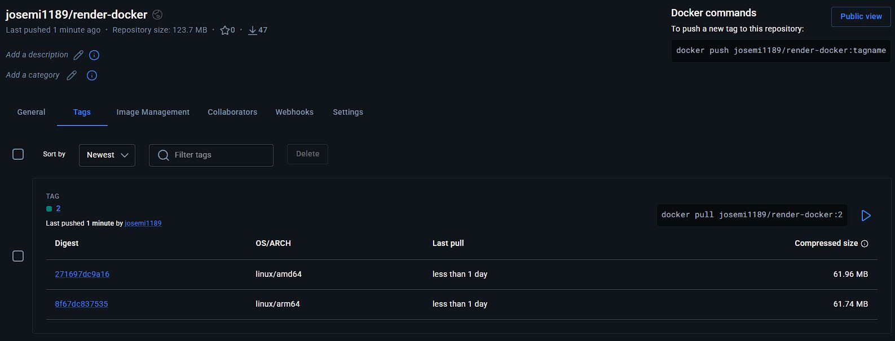

6. Para publicar en Render, debemos generar un **Web Service** y enlazar con nuestro repositorio de GitHub con la diferencia de que al elegir el lenguaje utilizado deberá estar seleccionado **Docker**.

   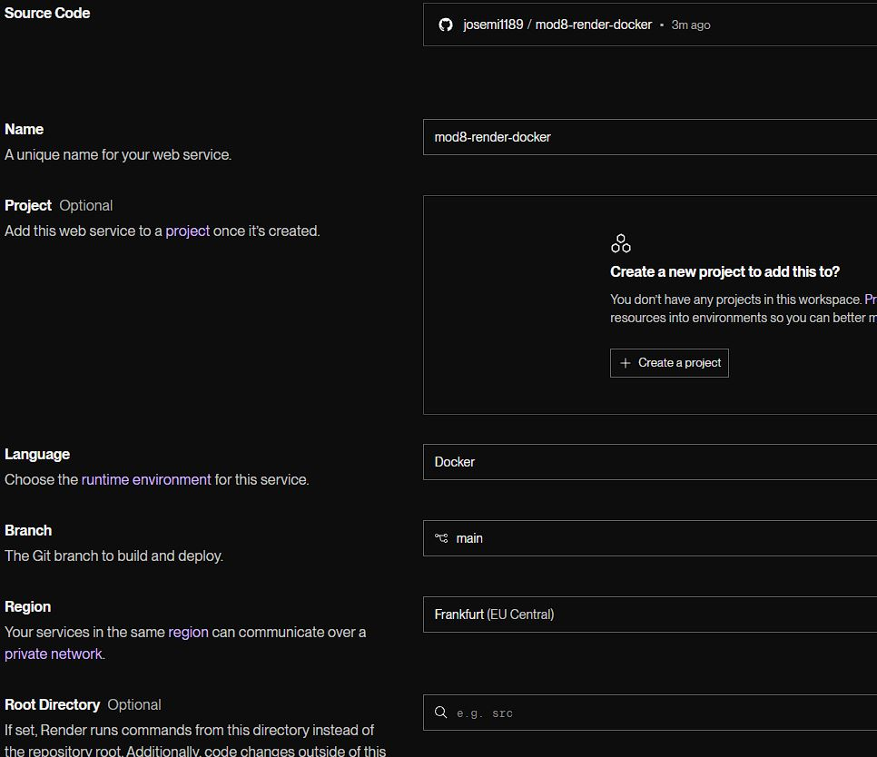

   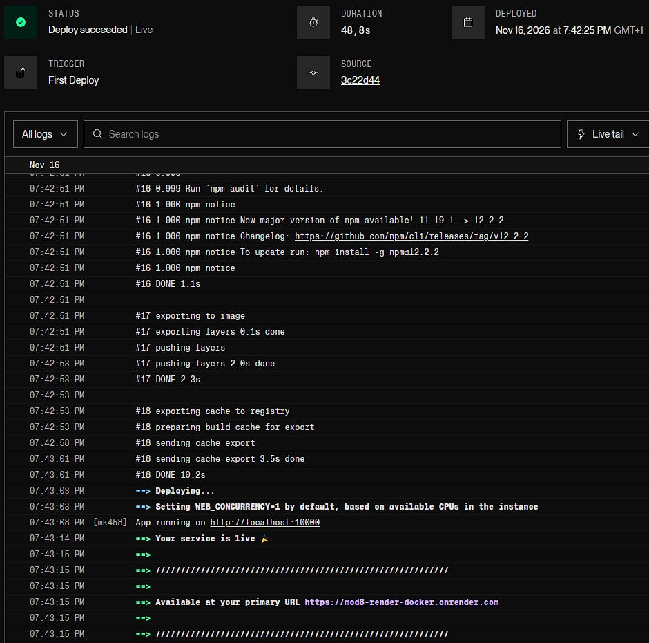

---

<br>

# DESPLIEGUE EN AWS USANDO DOCKER

🔗 [Repositorio GitHub](https://github.com/josemi1189/mod8-render-docker)

🔗 [Despliegue en AWS con Docker](http://ec2-16-171-21-76.eu-north-1.compute.amazonaws.com)

Utilizaremos una instancia EC2 (servidor virtual en AWS) utilizando la imagen subida a Docker Hub en el repositorio utilizado para desplegar en **Render** utilizando **Docker**.

1. En el buscador de aplicaciones de **AWS** buscaremos la opción **EC2**.
2. Entramos en `Lanzar la instancia`.
3. AWS no activa el certificado **SSL** por defecto si no que debemos obtener un certificado e instalarlo manualmente. Para esta prueba se habilitará la opción **Permitir el tráfico de HTTP desde Internet**.

   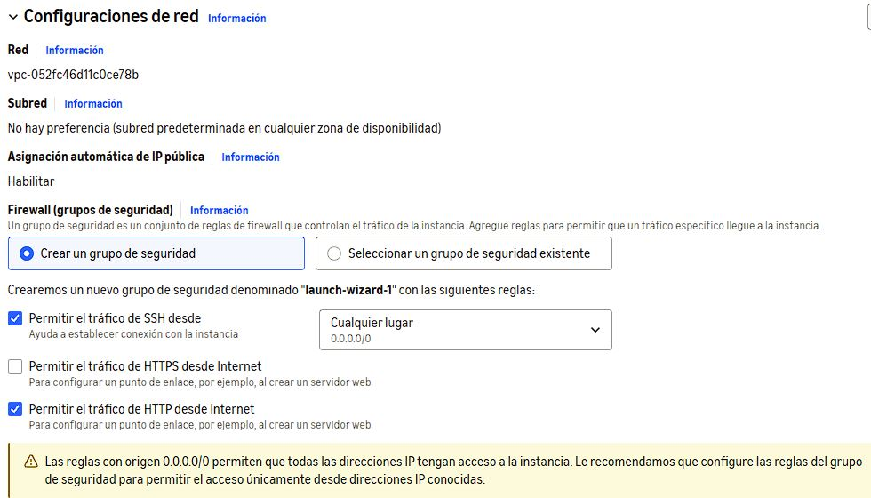

4. Una vez configurado, lanzamos la instancia y seleccionamos la opción de "Continuar sin un par de claves" para que no genere claves SSH.

   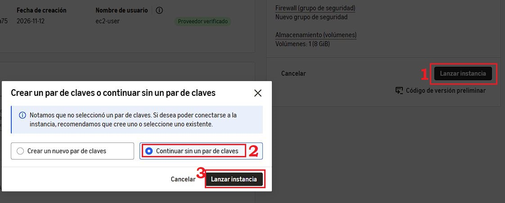

5. Una vez creada la instancia, nos conectamos desde el propio navegador y nos deberá aparecer la ventana con línea de comandos en el propio navegador.

   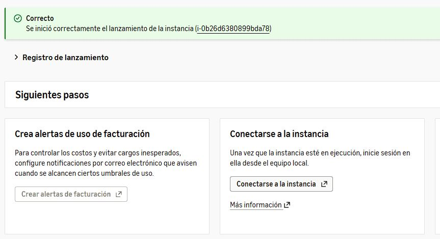

   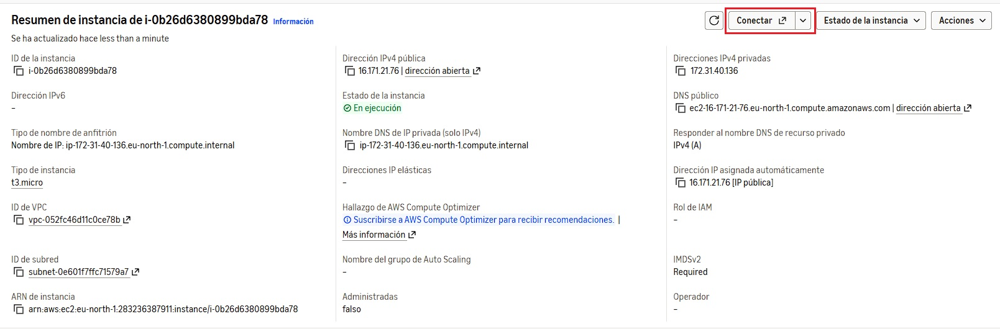

6. Una vez conectados deberemos instalar todo lo necesario ya que es una máquina Linux sin nada instalado. Para este caso instalaremos lo siguiente:
   - Gestor de paquetes del sistema operativo Linux de la máquina virtual en AWS.

     ```
     sudo yum update -y
     ```

     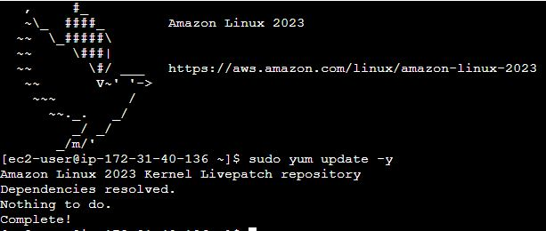

   - Instalamos Docker.

     ```
     sudo yum install docker
     ```

     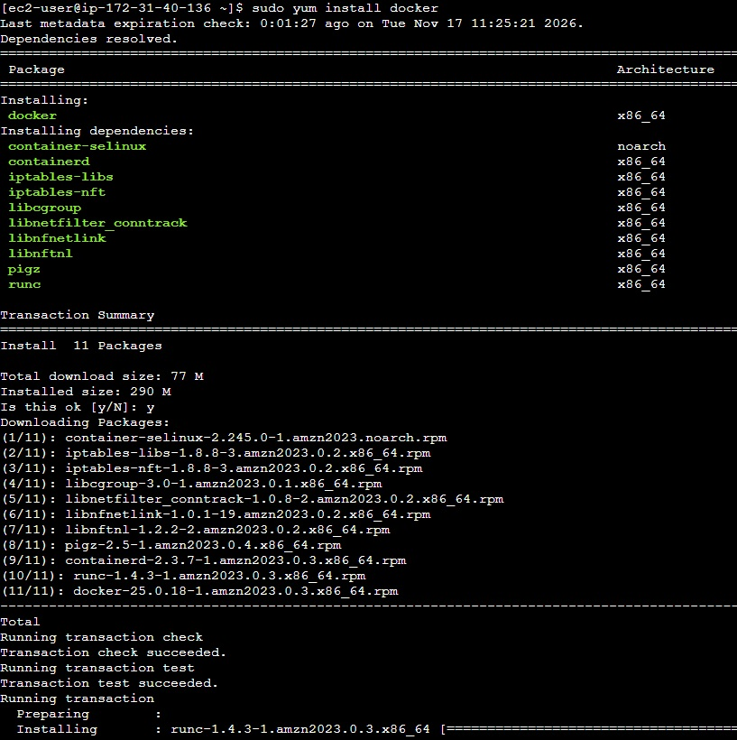

   - Arrancamos el servidor de Docker.

     ```
     sudo service docker start
     ```

     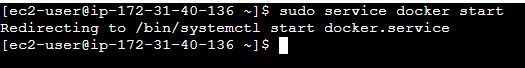

   - Una ves instalado e iniciado el servicio Docker podemos gestionarlo mediante línea de comandos igual que en local. Podemos crear un contenedor utilizando la imagen subida anteriormente a **Docker Hub**:
     `sudo docker run --name <nombre contenedor> -d -p <puerto mapeado>:<puerto configurado en imagen de Docker> <nombre imagen Docker Hub>:<versión imagen>`
     - **_-d:_** Evita que ocupe línea de comandos del terminal.
     - **_puerto mapeado:_** Puerto que utilizará para servir la aplicación. 80 (HTTP) o 443 (HTTPS)
     - **_puerto configurado en imagen de Docker:_** Es el puerto que se haya utilizado para generar la imagen.

     ```
     sudo docker run --name aws-container -d -p 80:8083 josemi1189/render-docker:2
     ```

     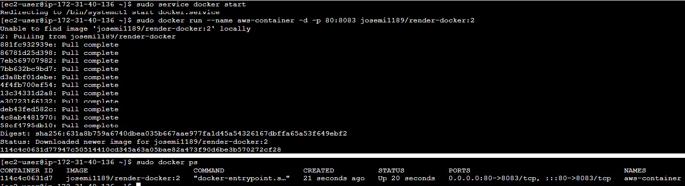

7. Una vez creado el contenedor podemos comprobar si se ha desplegado correctamente. Desde el panel de la instancia creada, en el apartado DNS público indica la url generada.

   > Si pulsamos sobre el enlace **dirección abierta**, se debe tener en cuenta que abrirá la página utilizando protocolo seguro y por lo tanto tendremos que cambiarlo a `http`.

   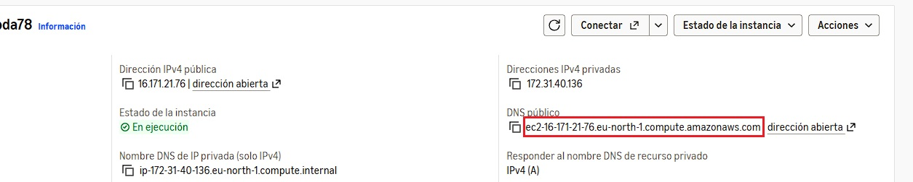
